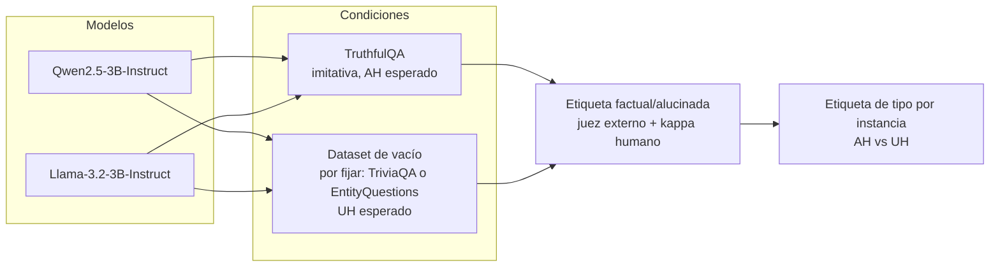
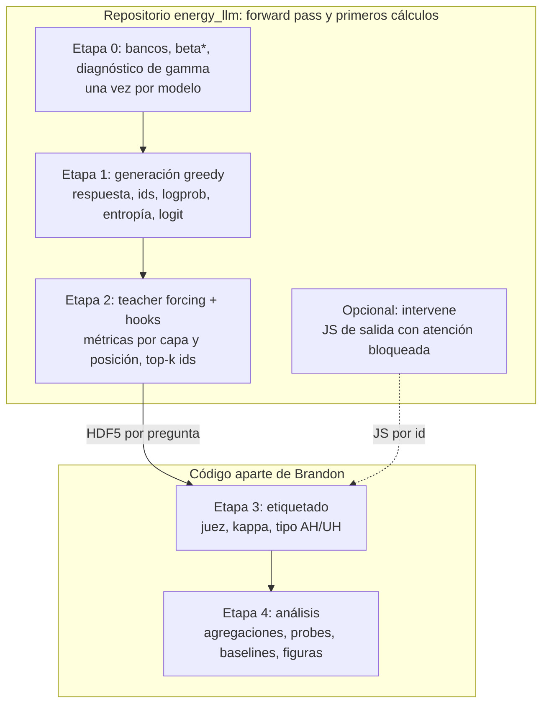
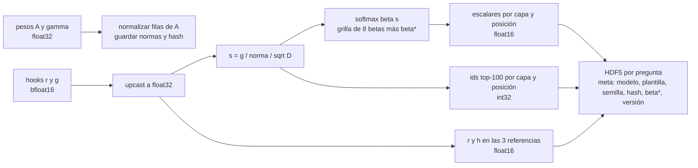

# Settling into the Wrong Memory
## Degeneración del mecanismo de recuperación en la memoria feed-forward de LLM

Documento de trabajo del proyecto (versión 0.2, noviembre 2026). Sustituye al plan de octubre y a la versión 0.1. Alcance acotado: una afirmación, dos partes, un repositorio que termina en la extracción.

---

## 1. De qué trata

Un modelo de lenguaje de pesos abiertos responde preguntas de hecho. En cada capa leemos cómo el estado oculto que entra al sublayer feed-forward (SwiGLU) interactúa con las filas de la matriz de compuerta, tratadas como banco de memorias de una red de Hopfield moderna. De ahí salen energías, entropías y divergencias que describen la *trayectoria de recuperación* de una respuesta a lo largo de capas y tokens.

La pregunta no es solo si la respuesta es falsa, sino **cómo falla la recuperación**:

| Régimen | Lectura Hopfield | Firma esperada | Literatura previa |
|---|---|---|---|
| Alucinación no asociada (UH) | la query nunca entra en una cuenca | entropía alta sostenida, poca masa top-k, conjunto de memorias inestable entre tokens | Cheang et al. 2026 (UH); Simhi et al. 2024 (HK−) |
| Alucinación asociada (AH) | compromiso temprano y profundo con una cuenca bien formada pero incorrecta | energía y entropía indistinguibles de la recuperación correcta; diferencia posible solo en competencia (varianza de scores) | Cheang et al. 2026 (AH); Simhi et al. 2024 (HK+); Cherukuri y Varshney 2026 |

Lo que nadie tiene: un observable de **un solo pase**, fijado por teoría, sobre la **memoria FFN**, que muestra en qué régimen está una respuesta y explica por qué los detectores internos se degradan en el régimen AH.

---

## 2. La afirmación del artículo

**Los detectores internos se degradan en las alucinaciones asociadas porque lo que leen es compromiso con la memoria paramétrica, y el compromiso es el mismo en una recuperación correcta y en una incorrecta.**

- **H1 (degradación por tipo).** Las métricas de concentración ($E_{\mathrm{lse}}$, $\bar H$, $D_{\mathrm{JS}}$ frente a la referencia) separan FA de UH con AUROC alto y FA de AH cerca del azar. Incluye como resultado descriptivo el signo de $\Delta\bar H$ por tipo (UH más difusa que FA; AH igual o más concentrada).
- **H2 (lo que queda).** En el estrato AH, las métricas de competencia y estabilidad ($\mathrm{Var}_\beta(s)$, Jaccard top-k entre tokens consecutivos) conservan poder discriminante donde la concentración lo pierde.

Falsación: si el diagnóstico de dimensiones atípicas (§6.3) invierte el signo de $\Delta\bar H$, el efecto de energía en capas superficiales se declara artefacto de magnitud y se retira.

Fuera de alcance (otros artículos): alineación de la actualización real con la regla Hopfield, atractor genérico de la plantilla, energía nativa sin $\beta$, localización por capa como hallazgo, escala de modelo.

---

## 3. Marco formal (mínimo)

Capa $l$ y posición $t$; se omite $(l)$ cuando no hay ambigüedad.

- Punto de sonda: $r_t = \mathrm{RMSNorm}(\tilde h_t) = \hat x_t \odot \gamma$, con $\|\hat x_t\|_2 = \sqrt D$.
- Sublayer: $\mathrm{FFN}(r) = \big(\mathrm{SiLU}(A r) \odot B r\big)^\top C$, con $A, B \in \mathbb R^{K\times D}$ (compuerta y rama lineal), $C \in \mathbb R^{K\times D}$.
- Banco: $M = A$, filas $m_i$; banco normalizado $\hat M$, filas $\hat m_i = m_i/\|m_i\|$.
- Pre-activaciones nativas: $g = A r$.
- Scores: $s_i = g_i/(\|m_i\|\sqrt D) = \|r\|\cos\theta_i/\sqrt D$.
- Distribución de recuperación: $p_i(\beta) = \mathrm{softmax}(\beta s)_i$.
- Energía (Ramsauer et al. 2021), descompuesta: $E_{\mathrm{lse}} = -\tfrac1\beta\log\sum_i e^{\beta s_i}$, $E_{\mathrm{norm}} = \tfrac12\|r\|^2$.
- Termodinámica de la lectura: $\partial(\beta E_{\mathrm{lse}})/\partial\beta = -\langle s\rangle_\beta$ y $\partial^2(\beta E_{\mathrm{lse}})/\partial\beta^2 = -\mathrm{Var}_\beta(s)$.

Tres niveles de correspondencia que el artículo declara: la compuerta como banco es una elección de modelado; el softmax es una lectura, no el mecanismo; no se ejecuta ninguna iteración de Hopfield.

---

## 4. Diseño experimental

- Celdas: 2 modelos x 2 condiciones. Tamaños y segunda condición de vacío se fijan tras el piloto.
- Etiqueta de corrección: juez externo con prompt bloqueado, respuestas archivadas, $\kappa$ frente a subconjunto humano ($n \ge 60$ por celda).
- Etiqueta de tipo **por instancia**: para cada respuesta alucinada, una forward con la atención del sujeto hacia el último token bloqueada (Geva et al. 2023; Cheang et al. 2026). JS de salida por encima de la media observada en FA: AH; por debajo: UH. La condición de dataset es covariable, no asignación de tipo.
- Baselines: confianza de salida (logprob medio, entropía media, media del logit negativo del token elegido); probe lineal sobre el residual en las posiciones de referencia; probe lineal sobre las métricas de recuperación.
- Evaluación: AUROC por estrato (FA vs UH, FA vs AH), validación cruzada repetida y estratificada, bootstrap pareado.

---

## 5. Pipeline y reparto de responsabilidades

El repositorio recibe solo identificador y pregunta. No conoce oro, juez ni etiquetas. Todo se une por identificador.

### Etapa 0 (una vez por modelo)
1. Extraer $A^{(l)}$ de los pesos congelados; guardar $\|m_i\|$ y $\hat M^{(l)}$ en float32 con hash.
2. Diagnóstico de $\gamma$: las 5 dimensiones de mayor $|\gamma^{(l)}|$ por capa, guardadas en el manifiesto.
3. $\beta^\star$: uno por modelo, calibrado en 200 preguntas de un corpus neutro ajeno a las condiciones, objetivo $\bar H^\star = 0{,}55$ en la posición de referencia, interpolación en $\log\beta$. Nunca por dataset ni por pregunta.

### Etapa 1
Plantilla de chat fija, greedy, tope de tokens fijo, semilla fija. Se guardan respuesta, ids del prompt y de la respuesta, y por token generado: logprob, entropía de salida, logit del token elegido.

### Etapa 2
Un forward con teacher forcing sobre prompt + respuesta. Hooks: salida de `gate_proj` ($g$) y entrada de `mlp` ($r$). Por capa y posición se calculan las métricas de §6 y se descartan los vectores de tamaño $K_l$. Posiciones de referencia guardadas: último token de contenido de la pregunta, último token del prompt (token de plantilla), primer token generado.

### Etapas 3 y 4 (fuera del repositorio)
Etiquetado, estratificación AH/UH, agregaciones sobre tokens y capas (media, último, máximo, dispersión, pendiente, capa de compromiso, Jaccard entre tokens), probes, AUROC por estrato, sensibilidad a $\beta$ desde la grilla, ablaciones.

---

## 6. Métricas

### 6.1 Núcleo (siempre se calcula)

| Métrica | Definición | Para qué | $\beta$ |
|---|---|---|---|
| $E_{\mathrm{lse}}$ | $-\tfrac1\beta\log\sum_i e^{\beta s_i}$ | concentración (H1) | grilla |
| $E_{\mathrm{norm}}$ | $\tfrac12\|r\|^2$ | confusor de magnitud, separado | no |
| $\bar H$ | $H(p)/\log K$ | concentración (H1) | grilla |
| masa top-10 | $\sum_{i\in\mathrm{top10}} p_i$ | compromiso (H1) | grilla |
| $\mathrm{Var}_\beta(s)$ | $\sum_i p_i(s_i-\langle s\rangle)^2$ | competencia (H2) | grilla |
| $D_{\mathrm{JS}}(p_t\|p_{\mathrm{ref}})$ | simétrica, acotada | desplazamiento entre fases (H1) | grilla |
| $\Delta_{\mathrm{KL}}$ | $D_{\mathrm{KL}}(p_t\|p_{\mathrm{ref}}) - D_{\mathrm{KL}}(p_{\mathrm{ref}}\|p_t)$ | estrechamiento vs deriva (H1, H2) | grilla |
| ids top-100 | índices de los 100 mayores $s_i$ | Jaccard frente a referencia y entre tokens consecutivos (H2), en análisis | no |
| salida por token | logprob, entropía, logit del elegido | baselines | no |

Las comparativas se calculan frente a las tres referencias. Hellinger se elimina (redundante con JS; diferencia menor a 0,005 AUROC en los tres experimentos previos).

### 6.2 Extras (`extras: false` por defecto)
Energía nativa $E_{\mathrm{nat}}$ con $F(z)=z\,\mathrm{softplus}(z)+\mathrm{Li}_2(-e^z)$; razón de participación de los coeficientes nativos $a_i$; $\|\mathrm{FFN}(r)\|$ y cosenos de $\mathrm{FFN}(r)$ con $r$ y con $\bar m - r$; Spearman entre scores; distribución nula de la plantilla vacía. Requieren hooks adicionales (`up_proj`, salida de `mlp`).

### 6.3 Diagnóstico de dimensiones atípicas (piloto y ablación)
Recalcular $s$ excluyendo las 5 dimensiones de mayor $|\gamma|$ por capa. Reportar la fracción de $\mathrm{Var}_i(s_i)$ atribuible a ellas y si cambia el signo de $\Delta\bar H$. Se ejecuta en el piloto y queda como bandera `drop_outlier_dims` para la ablación.

---

## 7. Tratamiento de datos

- Modelo en bfloat16; métricas en float32 tras upcast; almacenamiento float16 salvo ids.
- Grilla de $\beta$: 8 valores log-espaciados entre 0,5 y 20, más $\beta^\star$. Toda métrica dependiente de $\beta$ se guarda para cada valor.
- No se guardan vectores de scores completos ($K_l\times L\times T\times N$ supera los 40 GB). Los ids top-100 bastan para Jaccard e inspección cualitativa.
- Esquema HDF5: `/meta`, `/tokens` (ids, logprob, entropía, logit), `/metrics/{nombre}` con forma $(L,T,n_\beta)$ o $(L,T)$, `/topk/ids` con forma $(L,T,100)$, `/ref/{contenido,plantilla,primero}/{r,h}` con forma $(L,D)$.
- Coste (Qwen 3B, $L=36$, $T\approx 40$): menos de 1,5 MB por pregunta; 2.000 preguntas por celda, menos de 3 GB.

---

## 8. Invariantes del piloto (50 preguntas, un modelo)

1. Estados con teacher forcing iguales a los de generación: $\|\Delta r\|/\|r\| < 10^{-3}$ en todas las capas.
2. $g$ capturado en `gate_proj` igual a $A r$ con $r$ capturado en la entrada de `mlp` (manejo de $\gamma$ correcto).
3. $\bar H$ en la referencia dentro de $0{,}55\pm0{,}05$ con $\beta^\star$.
4. Diagnóstico de $\gamma$ ejecutado y reportado antes de escalar.
5. Determinismo: dos ejecuciones con la misma semilla producen archivos idénticos en ids y métricas hasta float16.

---

## 9. Referencias que fijan la posición

- Ramsauer et al. 2021, Hopfield networks is all you need.
- Krotov y Hopfield 2016 y 2021, dense associative memory.
- Geva et al. 2021 (FFN como memoria clave-valor); Geva et al. 2023 (flujo sujeto a último token).
- Gupta et al. 2025 (down-projection como memoria asociativa lineal).
- Cheang, Chan, Zhang y Deng 2026 (AH/UH; los estados internos reflejan recuperación, no veracidad).
- Simhi et al. 2024 (HK−/HK+, WACK); Orgad et al. 2025 (tokens de respuesta exacta).
- Cherukuri y Varshney 2026 (cuencas de alucinación).
- Vu et al. 2025, HalluField; Ma et al. 2026, Semantic Energy (energía sobre logits, competidores directos).

