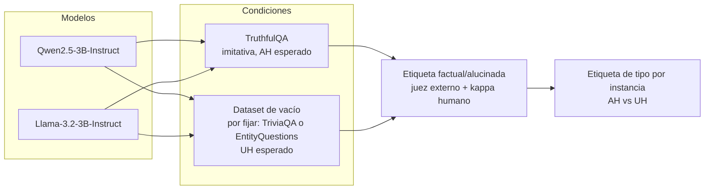
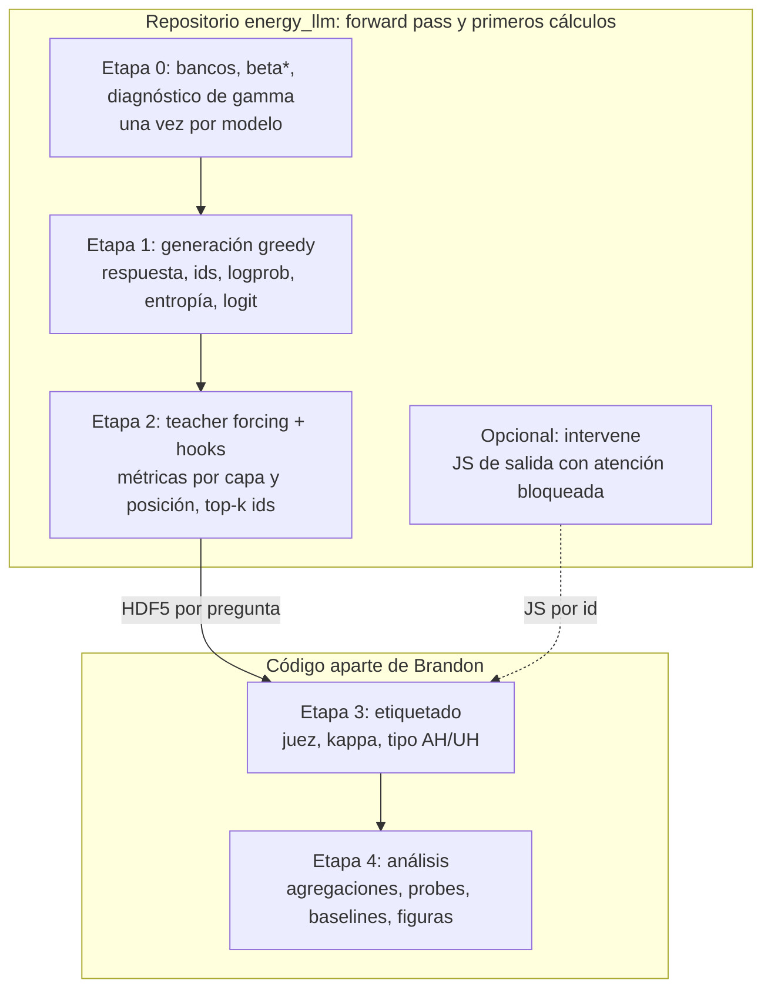
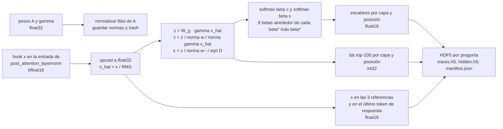

# Settling into the Wrong Memory
## Degeneración del mecanismo de recuperación en la memoria feed-forward de LLM

Documento de trabajo del proyecto (versión 0.2, noviembre 2026). Sustituye al plan de octubre y a la versión 0.1. Alcance acotado: una afirmación, dos partes, un repositorio que termina en la extracción.

---

## 1. De qué trata

Un modelo de lenguaje de pesos abiertos responde preguntas de hecho. En cada capa leemos cómo el estado oculto que entra al sublayer feed-forward (SwiGLU) interactúa con las filas de la matriz de compuerta, tratadas como banco de memorias de una red de Hopfield moderna. De ahí salen energías, entropías y divergencias que describen la *trayectoria de recuperación* de una respuesta a lo largo de capas y tokens.

La pregunta no es solo si la respuesta es falsa, sino **cómo falla la recuperación**:

| Régimen | Lectura Hopfield | Firma esperada | Literatura previa |
|---|---|---|---|
| Alucinación no asociada (UH) | la query nunca entra en una cuenca | entropía alta sostenida, poca masa top-k, conjunto de memorias inestable entre tokens | Cheang et al. 2026 (UH); Simhi et al. 2024 (HK−) |
| Alucinación asociada (AH) | compromiso temprano y profundo con una cuenca bien formada pero incorrecta | energía y entropía indistinguibles de la recuperación correcta; diferencia posible solo en competencia (varianza de scores) | Cheang et al. 2026 (AH); Simhi et al. 2024 (HK+); Cherukuri y Varshney 2026 |

Lo que nadie tiene: un observable de **un solo pase**, fijado por teoría, sobre la **memoria FFN**, que muestra en qué régimen está una respuesta y explica por qué los detectores internos se degradan en el régimen AH.

---

## 2. La afirmación del artículo

**Los detectores internos se degradan en las alucinaciones asociadas porque lo que leen es compromiso con la memoria paramétrica, y el compromiso es el mismo en una recuperación correcta y en una incorrecta.**

- **H1 (degradación por tipo).** Las métricas de concentración ($E_{\mathrm{lse}}$, $\bar H$, $D_{\mathrm{JS}}$ frente a la referencia) separan FA de UH con AUROC alto y FA de AH cerca del azar. Incluye como resultado descriptivo el signo de $\Delta\bar H$ por tipo (UH más difusa que FA; AH igual o más concentrada).
- **H2 (lo que queda).** En el estrato AH, las métricas de competencia y estabilidad ($\mathrm{Var}_\beta(s)$, Jaccard top-k entre tokens consecutivos) conservan poder discriminante donde la concentración lo pierde.

Falsación: si el diagnóstico de dimensiones atípicas (§6.3) invierte el signo de $\Delta\bar H$, el efecto de energía en capas superficiales se declara artefacto de magnitud y se retira.

Fuera de alcance (otros artículos): alineación de la actualización real con la regla Hopfield, atractor genérico de la plantilla, energía nativa sin $\beta$, localización por capa como hallazgo, escala de modelo.

---

## 3. Marco formal (mínimo)

Capa $l$ y posición $t$; se omite $(l)$ cuando no hay ambigüedad.

- Punto de sonda: el residual $x_t$ a la entrada de la segunda RMSNorm (`post_attention_layernorm`); $\hat x_t = x_t/\sqrt{\mathrm{mean}(x_t^2)+\epsilon}$, con $\|\hat x_t\|_2 \approx \sqrt D$, y $r_t = \mathrm{RMSNorm}(x_t) = \hat x_t \odot \gamma$.
- Sublayer: $\mathrm{FFN}(r) = \big(\mathrm{SiLU}(A r) \odot B r\big)^\top C$, con $A, B \in \mathbb R^{K\times D}$ (compuerta y rama lineal), $C \in \mathbb R^{K\times D}$.
- Banco: las filas $w_i$ de la compuerta $A$ son las claves; $\gamma$ es la ganancia efectiva de la RMSNorm del FFN (§3.1). $\tilde W = A\,\mathrm{diag}(\gamma)$, filas $\tilde w_i$. Nunca se materializa: se guardan $\gamma$, $\|w_i\|$ y $\|\tilde w_i\|$.
- Pre-activaciones nativas: $g = A r = A(\gamma\odot\hat x) = \tilde W \hat x$.
- Ganancia de la query: $g_t = \|\gamma\odot\hat x_t\|/\sqrt D$ (traza `query_gain`).
- Scores, dos variantes calculadas siempre (justificación en §6.0):
  - **principal** `cos_gamma_query`: $c_i = \cos(w_i, \gamma\odot\hat x) = g_i/(\|w_i\|\,\|\gamma\odot\hat x\|) \in [-1, 1]$: clave sin $\gamma$, consulta con $\gamma$; un coseno exacto.
  - **control** `cos_gamma_key` (la convención hasta el paso 9): $s_i = g_i/(\|\tilde w_i\|\sqrt D) = \cos(\tilde w_i, \hat x)\,\|\hat x\|/\sqrt D$: $\gamma$ plegada en la clave.
  - Relación: $s_i = g_t\,(\|w_i\|/\|\tilde w_i\|)\,c_i$. En ambas la norma de la query sale del score; no hay término $E_{\mathrm{norm}}$ ($\tfrac12\|\hat x\|^2 \approx D/2$ es constante).
- Distribución de recuperación: $p_i(\beta) = \mathrm{softmax}(\beta c)_i$ (principal) o $\mathrm{softmax}(\beta s)_i$ (control), cada una con su $\beta^\star$.
- Energía (Ramsauer et al. 2021): $E_{\mathrm{lse}} = -\tfrac1\beta\log\sum_i e^{\beta s_i}$, sin término cuadrático.
- Termodinámica de la lectura: $\partial(\beta E_{\mathrm{lse}})/\partial\beta = -\langle s\rangle_\beta$ y $\partial^2(\beta E_{\mathrm{lse}})/\partial\beta^2 = -\mathrm{Var}_\beta(s)$.

Tres niveles de correspondencia que el artículo declara: la compuerta como banco es una elección de modelado; el softmax es una lectura, no el mecanismo; no se ejecuta ninguna iteración de Hopfield.

### 3.1 Alcance

La lectura exige tres propiedades de la arquitectura, que el código comprueba con un adaptador por `model_type`:

- **pre-RMSNorm**: el FFN recibe $\mathrm{RMSNorm}(x) = \hat x\odot\gamma_{\mathrm{ef}}$, y su entrada $x$ es el punto de sonda. El adaptador devuelve la norma y la ganancia efectiva: $\gamma$ en Qwen2 y Llama; $1+\gamma$ en Gemma, cuya RMSNorm escala por $(1+\text{peso})$.
- **FFN con compuerta** (SwiGLU/GeGLU): la matriz de compuerta es el banco.
- **denso**: un único FFN por capa; un MoE tendría un banco por experto y un enrutador.

Implementado y probado: Qwen2 y Llama. Gemma queda fuera con un `NotImplementedError` documentado: además de la ganancia $1+\gamma$, Gemma 2/3 normalizan la salida de la atención en `post_attention_layernorm` y leen el FFN tras `pre_feedforward_layernorm`. Cualquier otra arquitectura se rechaza. Ningún índice de capa ni de dimensión está fijado en el código ni en la configuración: las bandas son por profundidad relativa $\ell/L$ y $d^\star$ se estima de los datos.

---

## 4. Diseño experimental

- Celdas: 2 modelos x 2 condiciones. Tamaños y segunda condición de vacío se fijan tras el piloto.
- Etiqueta de corrección: juez externo con prompt bloqueado, respuestas archivadas, $\kappa$ frente a subconjunto humano ($n \ge 60$ por celda).
- Etiqueta de tipo **por instancia**: para cada respuesta alucinada, una forward con la atención del sujeto hacia el último token bloqueada (Geva et al. 2023; Cheang et al. 2026). JS de salida por encima de la media observada en FA: AH; por debajo: UH. La condición de dataset es covariable, no asignación de tipo.
- Baselines: confianza de salida (logprob medio, entropía media, media del logit negativo del token elegido); probe lineal sobre el residual en las posiciones de referencia; probe lineal sobre las métricas de recuperación.
- Evaluación: AUROC por estrato (FA vs UH, FA vs AH), validación cruzada repetida y estratificada, bootstrap pareado.

---

## 5. Pipeline y reparto de responsabilidades

El repositorio recibe solo identificador y pregunta. No conoce oro, juez ni etiquetas. Todo se une por identificador.

### Etapa 0 (una vez por modelo)
1. Extraer $A^{(l)}$ de los pesos congelados; guardar $\|m_i\|$ y $\hat M^{(l)}$ en float32 con hash.
2. Diagnóstico de $\gamma$: las 5 dimensiones de mayor $|\gamma^{(l)}|$ por capa, guardadas en el manifiesto.
3. $\beta^\star$: uno por modelo **y por variante de score**, calibrado en un warm-up disjunto de la evaluación (y ajeno a las condiciones), objetivo $\bar H^\star = 0{,}55$, con $\bar H$ promediada sobre todas las capas y sobre el último token del prompt y los tokens de la respuesta; interpolación en $\log\beta$ sobre una rejilla logarítmica común; falla si alguna variante no queda acotada (nunca se recorta). Se informa la posición de cada $\beta^\star$ en la rejilla, con aviso a menos de 0,5 décadas del borde. Nunca por dataset ni por pregunta. `extract` se niega a correr si falta el $\beta^\star$ de alguna variante.

### Etapa 1
Plantilla de chat fija, greedy, tope de tokens fijo, semilla fija. Se guardan respuesta, ids del prompt y de la respuesta, y por token generado: logprob, entropía de salida, logit del token elegido.

### Etapa 2
Un forward con teacher forcing sobre prompt + respuesta, en `model.trace_dtype` (bfloat16 por defecto; float32 en una segunda instancia del mismo checkpoint si la regla de precisión de §8 lo recomienda). La generación sigue en el dtype del modelo. Hook: entrada de la RMSNorm del FFN ($x$); $g$ y las dos variantes de score se recalculan en float32. Por capa, posición y variante se calculan las métricas de §6 y se descartan los vectores de tamaño $K_l$. Posiciones de referencia guardadas: último token con rol pregunta (puntuación incluida), último token del prompt (token de plantilla), primer token generado.

### Etapas 3 y 4 (fuera del repositorio)
Etiquetado, estratificación AH/UH, agregaciones sobre tokens y capas (media, último, máximo, dispersión, pendiente, capa de compromiso, Jaccard entre tokens), probes, AUROC por estrato, sensibilidad a $\beta$ desde la grilla, ablaciones.

---

## 6. Métricas

### 6.0 Variante de score: por qué $\gamma$ va en la consulta

Hasta el paso 9 el score era $s_i = \cos(\gamma\odot w_i, \hat x)$. Como $\tilde w_i\cdot\hat x = w_i\cdot(\gamma\odot\hat x)$, se reescribe

$$s_i = g_t\,\frac{\|w_i\|}{\|\tilde w_i\|}\,c_i,\qquad g_t = \frac{\|\gamma\odot\hat x_t\|}{\sqrt D},\quad c_i = \cos(w_i, \gamma\odot\hat x_t).$$

Bajo $\mathrm{softmax}(\beta s)$, esa convención introduce:

- una **temperatura efectiva $\beta\,g_t$ que depende de la posición**;
- un peso por memoria $\|w_i\|/\|\tilde w_i\|$.

$g_t$ no es recuperación: mide cuánta masa de $\hat x_t$ cae en dimensiones con $|\gamma|$ grande. El residual tiene una dimensión con activación masiva, y la RMSNorm la anula. En el smoke del piloto (job 33014, Qwen2.5-3B), $d^\star = 1874$ es la dimensión dominante de $\hat x$, con $\gamma_{d^\star}\approx 0$ en las capas 7–11 y 32–34. Donde $\hat x_t$ concentra su masa en $d^\star$, $\|\gamma\odot\hat x_t\|$ cae, $g_t$ cae y $\bar H$ sube por ganancia, no por un cambio en la competencia entre memorias.

La variante principal `cos_gamma_query` usa la consulta que el FFN recibe realmente, $\gamma\odot\hat x$, la normaliza y compara con claves sin $\gamma$: un coseno exacto, sin esa temperatura. La convención anterior se conserva como control (`cos_gamma_key`), con las mismas trazas y su propio $\beta^\star$. $g_t$ se guarda como traza (`query_gain`) para separar ambos efectos en el análisis.

### 6.1 Núcleo (siempre se calcula)

Todas las trazas de la tabla se calculan para las dos variantes, en grupos HDF5 `<variante>/…`. Excepciones: `topk_ids` solo se guarda para la principal (`extraction.control_topk_ids_k: 0`), y `query_gain` y `xhat_top1_frac` no dependen de las memorias, así que se guardan una sola vez.

| Métrica | Definición | Para qué | $\beta$ | Dataset (`traces.h5`) |
|---|---|---|---|---|
| $E_{\mathrm{lse}}$ | $-\tfrac1\beta\log\sum_i e^{\beta s_i}$ | concentración (H1) | grilla | `energy` |
| $\bar H$ | $H(p)/\log K$ | concentración (H1) | grilla | `norm_entropy` |
| masa top-10 | $\sum_{i\in\mathrm{top10}} p_i$ | compromiso (H1) | grilla | `topk_mass` |
| $\langle s\rangle_\beta$ | $\sum_i p_i s_i$ | primera derivada de $\beta E_{\mathrm{lse}}$ | grilla | `mean_score` |
| $\mathrm{Var}_\beta(s)$ | $\sum_i p_i(s_i-\langle s\rangle)^2$ | competencia (H2) | grilla | `var_score` |
| $D_{\mathrm{JS}}(p_t\|p_{\mathrm{ref}})$ | simétrica, acotada | desplazamiento entre fases (H1) | grilla | `js/<ref>` |
| $\Delta_{\mathrm{KL}}$ | $D_{\mathrm{KL}}(p_t\|p_{\mathrm{ref}}) - D_{\mathrm{KL}}(p_{\mathrm{ref}}\|p_t)$ | estrechamiento vs deriva (H1, H2) | grilla | `dkl/<ref>` |
| margen | $s_{(1)} - s_{(2)}$ | separación del ganador | no | `margin` |
| fracción top-1 de $\hat x$ | $\max_j \hat x_j^2/D$ | activaciones masivas (diagnóstico) | no | `xhat_top1_frac` |
| ganancia de la query | $g_t = \|\gamma\odot\hat x_t\|/\sqrt D$ | temperatura efectiva de la variante de control (§6.0) | no | `query_gain` |
| ids top-100 | índices de los 100 mayores scores | Jaccard frente a referencia y entre tokens consecutivos (H2), en análisis | no | `cos_gamma_query/topk_ids` |
| salida por token | logprob, entropía, logit del elegido | baselines | no | `answers.parquet`: `token_logprobs`, `token_entropies`, `token_logits`; `baselines.parquet` |

`<ref>` ∈ {`question_last`, `prompt_last`, `response_first`}: último token de la pregunta, último token del prompt, primer token generado. Las comparativas se calculan frente a las tres referencias. Hellinger se elimina (redundante con JS; diferencia menor a 0,005 AUROC en los tres experimentos previos).

### 6.2 Extras (no implementados en v2.1.0)
Energía nativa $E_{\mathrm{nat}}$ con $F(z)=z\,\mathrm{softplus}(z)+\mathrm{Li}_2(-e^z)$; razón de participación de los coeficientes nativos $a_i$; $\|\mathrm{FFN}(r)\|$ y cosenos de $\mathrm{FFN}(r)$ con $r$ y con $\bar m - r$; Spearman entre scores; distribución nula de la plantilla vacía. Requieren hooks adicionales (`up_proj`, salida de `mlp`).

### 6.3 Diagnóstico de dimensiones atípicas (piloto y ablación)
Por capa se guardan las 5 dimensiones de mayor $|\gamma|$ y la fracción de $\sum_i\|\tilde w_i\|^2$ que cargan (`bank.h5`, `manifest.json: gamma_diagnostic`). Para cada variante, el `smoke` recalcula las métricas con esas 5 entradas de $\gamma$ a cero y también con $d^\star$ a cero. Reporta, por capa y por tercio de profundidad relativa $\ell/L$:

- $\Delta\bar H$ frente a `prompt_last` y frente a `question_last` (respuesta − referencia), y la JS;
- todo ello a $\beta^\star$ y al $\beta$ re-emparejado: aquel en que el banco ablacionado recupera la $\bar H(\text{prompt\_last})$ media del intacto;
- la distribución de $g_t$ por rol y por banda.

**Regla de exclusión de capas** (se reporta, no se aplica):

- Se excluye siempre la primera capa.
- Se excluyen además las capas en que la ablación de $\gamma$ top-5, al $\beta$ re-emparejado, invierte el signo de $\Delta\bar H$ (respuesta − `prompt_last`), siempre que se cumplan las tres condiciones:
  - $|\Delta\bar H| > 0{,}02$ en los dos lados (intacto y ablacionado);
  - los dos IC bootstrap del 95 % sobre preguntas ($B = 1000$, remuestreos pareados, semilla fija) excluyen 0;
  - los dos IC tienen signos opuestos.
- La misma regla a $\beta^\star$ se reporta, pero no cuenta.
- Se calcula para las dos variantes; la lista propuesta sale solo de `cos_gamma_query`.

No hay bandera de ablación en producción.

---

## 7. Tratamiento de datos

- Generación en bfloat16. El forward con teacher forcing de las trazas va en `trace_dtype` (bfloat16 por defecto). Métricas en float32 tras upcast; almacenamiento float16 salvo ids.
- Grilla de $\beta$, **relativa al $\beta^\star$ de cada variante**: $\beta^\star_v\cdot 10^{o}$, con 9 desplazamientos $o$ equiespaciados entre $-0{,}7$ y $+0{,}9$ décadas (pasos de 0,2; `extraction.beta_grid_log10_offset`), más $\beta^\star_v$ al final: $n_\beta = 10$. Toda métrica dependiente de $\beta$ se guarda para cada valor. *(Revisado en el paso 10: la grilla absoluta $10^0$…$10^4$ ya no tiene sentido con dos variantes de $\beta^\star$ distinto; la relativa da la misma resolución alrededor de cada punto de trabajo.)*
- No se guardan vectores de scores completos ($K_l\times L\times T\times N$ supera los 40 GB). Los ids top-100 bastan para Jaccard e inspección cualitativa.
- Esquema (`$SCRATCH_ROOT/energy_llm/runs/<modelo>/extract/<nombre>/`): `traces.h5` con `/<id>/<variante>/{energy, norm_entropy, topk_mass, mean_score, var_score, js/<ref>, dkl/<ref>}` de forma $(L,T,n_\beta)$, `/<id>/<variante>/margin` $(L,T)$, `/<id>/cos_gamma_query/topk_ids` $(L,T,100)$ int32, `/<id>/{query_gain, xhat_top1_frac}` $(L,T)$, `/<id>/role_mask` $(T)$ y atributos `variants`, `betas` y `beta_star` por variante y `reference_positions`; `hidden.h5` con `/<id>/{question_last, prompt_last, response_first, response_last}` $(L,D)$; tokens, logprob, entropía y logit en `answers.parquet`; procedencia en `manifest.json`.
- Coste (Qwen 3B, $L=36$, $T\approx 90$, $n_\beta = 10$): unos 4 MB por pregunta antes de gzip, con dos variantes. No guardar `topk_ids` del control ahorra $L\cdot T\cdot 100\cdot 4$ bytes ≈ 1,3 MB por pregunta antes de gzip; el smoke mide el ahorro real.

---

## 8. Invariantes del piloto (50 preguntas, un modelo)

Todos los criterios que pasan por el banco se exigen en las dos variantes de score: la de control también va al artículo como evidencia.

1. **Estados con teacher forcing equivalentes a los de generación**, juzgados por su efecto en las trazas.
   - Criterio: en cada capa $\ell$, el p99 sobre preguntas y **posiciones de análisis** de $|\Delta\bar H|$, $|\Delta E_{\mathrm{lse}}|$ y $D_{\mathrm{JS}}(p_{\mathrm{cache}}\|p_{\mathrm{tf}})$, a $\beta^\star_v$, no supera $0{,}1\,\sigma_\ell$ (ruido/señal $\le 0{,}1$).
   - $\sigma_\ell$ es la desviación estándar de la métrica entre posiciones de respuesta y preguntas. Se reporta junto al cociente, para distinguir un ruido grande de un $\sigma$ pequeño (capas 26–27 del piloto).
   - Posiciones de análisis = tokens de respuesta ∪ {`question_last`, `prompt_last`, `response_first`}.
   - Los tokens deben coincidir.
   - Desglose informativo: por rol (plantilla, instrucción, pregunta, respuesta) y por posición especial (posición 0 y las tres referencias), con mediana, p99, máximo y cociente por capa. También se reportan $\|\Delta x\|/\|x\|$ y la distancia de ambos estados a un forward en float32.
   - *Revisado tras el piloto, primera vez:* en bfloat16 $\|\Delta x\|/\|x\|$ llegó a 0,09 con tokens idénticos; lo relevante es si ese ruido mueve las métricas frente a su dispersión entre preguntas.
   - *Revisado tras el piloto, segunda vez (verify 33019):*
     - TF y caché bf16 quedan a la misma distancia de float32 en todas las capas (cociente ≈ 1): el 9 % es el piso de bf16 y el TF es canónico.
     - El exceso aparece en las capas ≥ 30, con p99 ≈ máximo.
     - El máximo de `tf_vs_cache` está en la posición 0, de rol plantilla (probable sumidero de atención), que el análisis no lee. Por eso el criterio se evalúa solo sobre las posiciones de análisis; plantilla y posición 0 se reportan aparte.
   - **Regla de precisión** (preregistrada): si el cociente p99/$\sigma_\ell$ de las trazas bf16 frente a float32, sobre las posiciones de análisis, supera 0,1 en alguna capa y variante, `verify` imprime `RECOMMEND trace_dtype=float32`. Las trazas se recalculan entonces en float32, con la generación en bf16.
2. $g$ capturado en `gate_proj` se reproduce a partir de $\hat x$ capturado en la entrada de la RMSNorm del FFN, como $\|w_i\|\,\|\gamma\odot\hat x\|\,c_i$ (principal) y como $\|\tilde w_i\|\sqrt D\,s_i$ (control): manejo de $\gamma$ correcto.
3. $\bar H$ en la referencia dentro de $0{,}55\pm0{,}05$ con $\beta^\star_v$, para cada variante. Se reporta también la posición de $\beta^\star_v$ en la rejilla de calibración.
4. Diagnóstico de $\gamma$ ejecutado y reportado antes de escalar.
5. Determinismo: dos ejecuciones con la misma semilla producen archivos idénticos en ids y métricas hasta float16.
6. Desacuerdos teacher forcing / greedy: todo token en que el argmax con teacher forcing difiere del greedy tiene margen top1−top2 de logits (en ambas pasadas) menor que $\delta = \max(\text{p99 de } \max_v|\ell_{\mathrm{gen}}-\ell_{\mathrm{tf}}| \text{ en las posiciones no divergentes},\ 3\,\mathrm{ulp}_{\mathrm{bf16}}(|\ell_{\mathrm{top1}}|))$: es decir, son casi-empates volteados por la discrepancia numérica entre ambas pasadas, no errores de alineación. Los desacuerdos se registran y no son fatales. *(Revisado tras el piloto: TF == greedy en el 99,64 % de los tokens; el requisito previo de igualdad al 100 % no es alcanzable en bfloat16.)*

---

## 9. Referencias que fijan la posición

- Ramsauer et al. 2021, Hopfield networks is all you need.
- Krotov y Hopfield 2016 y 2021, dense associative memory.
- Geva et al. 2021 (FFN como memoria clave-valor); Geva et al. 2023 (flujo sujeto a último token).
- Gupta et al. 2025 (down-projection como memoria asociativa lineal).
- Cheang, Chan, Zhang y Deng 2026 (AH/UH; los estados internos reflejan recuperación, no veracidad).
- Simhi et al. 2024 (HK−/HK+, WACK); Orgad et al. 2025 (tokens de respuesta exacta).
- Cherukuri y Varshney 2026 (cuencas de alucinación).
- Vu et al. 2025, HalluField; Ma et al. 2026, Semantic Energy (energía sobre logits, competidores directos).

